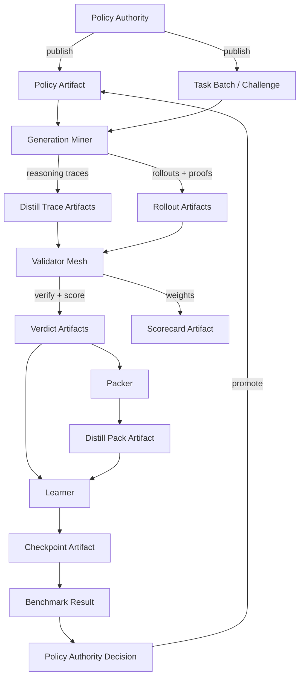

[](https://www.python.org/)
[](LICENSE)

# Reliquary Forge

**Reliquary Forge** is the trainer-quorum runtime for [Reliquary](https://github.com/0xgrizz/reliquary-inference),
a two-subnet Bittensor platform for proof-carrying AI training. Forge consumes
**verified rollout groups** from the live [Ledger runtime](https://github.com/0xgrizz/reliquary-inference)
and turns them into policy checkpoints through dual-lane training:

- **RL lane (live)**: DAPO/GRPO on zone-filtered rollout groups from Ledger's
  4-validator mesh — PPO-clipped surrogate + KL penalty against a frozen
  reference, published as `CheckpointAttestation + PolicyCommitment` that
  miners hot-swap at the effective window boundary.
- **Distillation lane**: miners generate reasoning traces, validators verify
  provenance and quality, packers export deterministic datasets, and learners
  produce student checkpoints.

Forge and its sibling Ledger share a [protocol package](https://github.com/0xgrizz/reliquary-protocol)
so the two subnets cross-verify deterministically.

## Live Status

- **Live closed-loop bridge** to Ledger netuid 462 — `scripts/run_forge_grpo_live.py`
  runs autonomously every 60 min via systemd timer
- **GRPO trainer** on zone-filtered groups (σ ≥ 0.33 bootstrap gate) with
  PPO clip ε=0.2, KL β=0.04 (k3 estimator), AdamW lr=5e-7
- **Cursor-memoised R2 scan** — per-cycle R2 cost dropped from ~900 gets to
  ~10 in steady state (20 min → 1.5 min cycle time)
- **Partial-seal gates**: drop σ=0 groups upfront + skip publishing deltas
  below a configurable `min_mean_abs_delta` threshold
- **R2 state mirror + auto-restore** — node rebuild no longer resets
  `last_trained_window`
- **First autonomous GRPO delta published**: `forge-grpo-1776864812` (merkle
  `87b30c85…`), with downstream `policy_consumer` applying it on Ledger
  miners within one window
- See [live operator guide](docs/rtx6000b-deployment.md) and the
  [closed-loop bridge spec](docs/architecture.md)

## Architecture



**Generation Miner**: produces reasoning traces or RL rollouts from the active policy.
**Validator Mesh**: verifies proofs or provenance, checks correctness, dedupes, screens contamination, and computes weights.
**Packer**: exports accepted reasoning traces into deterministic `jsonl` / `parquet` distillation packs.
**Learner**: consumes verified distill packs or RL training batches and emits checkpoints plus benchmark results.
**Policy Authority**: publishes active policy contracts and decides which checkpoints become canonical next policies.

## Design Principles

- End-to-end locally runnable with a single command
- Portable to a real Bittensor subnet
- Explicit about artifacts and policy contracts
- Dict-based, not Pydantic-based — inspectable and hashable
- Environment-agnostic protocol (SAT is the first environment)
- Dual-lane by design: reasoning-trace distillation plus benchmark-gated RL
- Managed-infra-ready: local by default, R2/Postgres/Redis-ready by interface

## Stack

- Python `3.12`
- `typer` CLI with `rich` output
- FastAPI control plane for artifact and policy APIs
- Local filesystem artifact registry plus R2 and metadata-index interfaces
- hidden-state sketch proofs over transformer activations
- Reasoning-trace teacher backends with provenance signatures
- Sequence-level clipped GRPO with backend abstraction for local, dense, and MoE-ready learners
- Ray-oriented trainer-quorum manifests for actor, learner, and evaluator workers
- Optional `transformers` / `trl` / `peft` / `accelerate` / `vllm` extras for GPU-backed training and serving
- Optional `ray` extra for multi-node trainer-quorum execution
- Optional Bittensor chain adapter (`bittensor 9.12.1`)

## Environments

- **sat**: miners solve generated k-SAT instances, submit rollouts with hidden-state sketch proofs, validators replay and score them, and the trainer turns accepted rollouts into GRPO-ready on-policy updates.
- **reasoning**: miners generate reasoning traces, validators check provenance, format, correctness, contamination, and novelty, then packers export reusable distillation datasets.
- **reasoning_rl**: finalized reasoning windows are imported through a live registry adapter and turned into RL-ready trajectories for dense or MoE-ready backends.
- **showcase**: a deterministic local-first coordination flow that simulates multiple miner archetypes and exports a static audit dashboard.

## Repository Layout

```
reliquary/                Python package
  control/                FastAPI control plane
  distill/                Teacher backends and trace provenance
  chain/                  Chain adapters (local + Bittensor)
  envs/                   SAT + reasoning environments
  protocol/               Artifact schemas, proof system, constants
  roles/                  Generation, validator mesh, packer, learner, policy authority
  scoring/                Uniqueness dedup and weight computation
  shared/                 Runtime configuration
  showcase/               RL + distillation demo orchestration and dashboards
  storage/                Local, R2, and metadata-indexed registries
  training/               GRPO and learner backends
  inference_adapter.py    Live registry adapter for finalized inference windows
  utils/                  JSON I/O, model loading
  cli.py                  Typer CLI entry point
docs/                     Technical documentation
deploy/ray/               Trainer-quorum manifests
tests/                    Unit tests
Dockerfile                Container image definition
docker-compose.yml        Local multi-service orchestration
```

## Commodity Data and Trainer Quorum

Reliquary treats finalized reasoning windows as an importable commodity surface for RL:

- reasoning verdicts carry deterministic reward inputs such as final answer, correctness, policy compliance, format status, difficulty, and contamination overlap
- the RL lane reads those finalized windows through an artifact-level registry adapter, not through shared Python internals
- imported windows materialize as environment-agnostic trajectories, verdicts, and training batches with explicit lineage back to the source registry and window ids
- dense RL uses a TRL/vLLM/FSDP2-oriented backend by default with two explicit modes:
  - `local_compat` for smoke and single-node bring-up
  - `ray_cluster` for the intended multi-node trainer quorum
- NeMo-oriented runs consume the same training-batch contract and emit compatible checkpoint and benchmark artifacts

## Setup

### Prerequisites

- Python `3.12`
- [`uv`](https://github.com/astral-sh/uv) for fast environment and package management
- Optional: Docker for containerized runs

### Local Install

```bash
# 1. Create local config
cp env.example .env

# 2. Create an isolated environment
uv venv
source .venv/bin/activate

# 3. Install the project
uv pip install -e ".[dev]"
```

For a GPU-backed node or a full remote learner environment, install the optional ML/GPU extras:

```bash
uv pip install -e ".[dev,ml,gpu]"
```

### First Showcase Run

```bash
# Full coordination demo
reliquary demo showcase

# Shorter deterministic profile for recordings
reliquary demo recording

# Reasoning-trace distillation demo
reliquary demo distill
```

Artifacts are written under `RELIQUARY_ARTIFACT_DIR`. Each demo run emits an export bundle under `RELIQUARY_EXPORT_DIR/<run-id>/` with:

- copied JSON artifacts for the run
- `run-manifest.json` and `chain-events.json`
- `dashboard/index.html` for the static audit view
- `SUMMARY.md` for a quick textual recap

Open the generated `dashboard/index.html` after the run to inspect window progression, miner outcomes, scorecards, and checkpoint lineage.

### Docker

```bash
cp env.example .env
docker compose up demo
```

All services share a `reliquary-data` volume. See [docs/configuration.md](docs/configuration.md) for container details.

### RTX6000B Remote Node

The first real deployment target is a private RTX6000B node running host-level Python services, not GPU containers. The full runbook lives in [docs/rtx6000b-deployment.md](docs/rtx6000b-deployment.md).

The deployment surface included in this repo now covers:

- Miniforge-based host bootstrap
- app and `vLLM` environment install scripts
- systemd units for `vLLM`, control plane, worker, backups, and the GitHub runner
- self-hosted GitHub Actions workflows for CPU CI and GPU deploys
- a remote env template for the `Qwen3-8B` teacher and `Qwen3-4B` student path

On the reference RTX6000B runtime, the `vLLM` service is configured in eager mode and with a reduced GPU memory utilization budget so the same node can still run the local LoRA learner. The host bootstrap also installs `build-essential`, because Triton needs a working C compiler during first model bring-up.

### Lightweight Inference Blueprint

The design rationale for a narrower inference-only subnet focused on proof-carrying completions and uniqueness scoring lives in [docs/lightweight-inference-subnet-blueprint.md](docs/lightweight-inference-subnet-blueprint.md).

### Public Repo Hygiene

- `.env`, `data/`, checkpoints, caches, and local editor files are intentionally ignored by Git.
- `env.example` is the public-safe starting point for configuration.
- The repo ships implementation docs only; planning artifacts and local agent settings are not part of the public tree.

## CLI Reference

```
reliquary publish-policy [--window 0]
    Publish a policy artifact for the given window.

reliquary publish-distill-policy [--window 0]
    Publish the active reasoning/distillation policy.

reliquary generate-challenges [--window 0] [--count 8]
    Generate SAT challenge artifacts for the given window.

reliquary generate-task-batch [--window 0] [--count 6]
    Generate a reasoning-task batch artifact for the given window.

reliquary mine [--window 0]
    Generate rollout artifacts with proofs for the given window.

reliquary distill-generate [--window 0]
    Generate reasoning-trace artifacts for the given window.

reliquary validate [--window 0]
    Verify rollouts and produce verdict + scorecard artifacts.

reliquary distill-validate [--window 0]
    Verify reasoning traces and produce verdict + scorecard artifacts.

reliquary pack-distill [--window 0]
    Build a deterministic distillation pack from accepted trace verdicts.

reliquary train [--window 0]
    Run GRPO training on accepted verdicts, save checkpoint, publish next policy.

reliquary import-inference-window [--window 0] [--source-window 6911280]
    Import one finalized reasoning window from the inference registry into RL artifacts.

reliquary run-rl-cycle [--window 0] [--source-window 6911280]
    Run one off-chain reasoning RL cycle from imported inference data through checkpoint gating.

reliquary status
    Print the current trainer-platform runtime summary, including RL worker state.

reliquary run-rl-worker [--once] [--start-window 0]
    Poll finalized inference windows and keep the reasoning RL lane moving autonomously, resuming from saved worker state when no explicit start window is provided.

reliquary distill-train [--window 0]
    Train the reasoning student backend from the latest distillation pack.

reliquary distill-cycle [--windows 2] [--tasks 256]
    Run the distillation lane end to end for one remote cycle.

reliquary run-distill-worker [--once]
    Loop distillation cycles for a durable remote worker service.

reliquary serve-control-plane
    Start the FastAPI control plane.

reliquary demo [showcase | recording | distill] [--windows N] [--challenges N] [--rollouts-per-challenge N]
    Run the full pipeline end-to-end with a named profile.
```

## Dual-Lane Flow

### Distillation lane

1. Policy authority publishes a reasoning policy.
2. Policy authority emits a `task_batch` artifact.
3. Generation miners produce `distill_trace` artifacts with teacher provenance.
4. Validator mesh checks provenance, correctness, contamination, and novelty.
5. Packer exports a `distill_pack` artifact plus `jsonl` / `parquet`.
6. Learner trains a student checkpoint and emits a benchmark result.
7. Policy authority promotes the checkpoint if the holdout result is acceptable.

### RL lane

1. Trainer publishes an RL policy describing the environment, reward contract, evaluator suite, and learner backend.
2. Importer reads one or more finalized reasoning windows from the live inference registry.
3. Imported trajectories materialize as RL rollouts and verdicts with explicit source lineage.
4. Learner groups accepted trajectories into RL batches and trains a checkpoint through the configured backend.
5. Evaluator measures benchmark deltas before and after training.
6. Policy authority promotes the checkpoint only if the benchmark gate passes.

## SAT Environment

The environment is deliberately simple and verifiable:

- A challenge is a randomly generated satisfiable k-SAT formula.
- Miners receive the formula in the prompt and respond with variable assignments.
- Validators compute:
  - `score`: binary (`1.0` only if all clauses satisfied).
  - `dense_reward`: fraction of clauses satisfied (smooth training signal).
  - `accepted`: proof-valid and format-valid rollout.

The dense reward gives the GRPO trainer gradient signal even when the model cannot yet solve the full instance. See [docs/sat-environment.md](docs/sat-environment.md) for details.

## Showcase

The `reliquary demo showcase` command runs a deterministic local demonstration with five differentiated miner archetypes:

| Archetype | Behavior | Expected Outcome |
|-----------|----------|------------------|
| `honest_high_quality` | Exact SAT assignments, valid proofs | Accepted, high reward |
| `honest_average` | Mix of exact, noisy, and partial | Accepted, moderate reward |
| `low_diversity` | Repeats the same valid completion | Penalized by uniqueness filter |
| `weak_policy` | Random guesses | Accepted but low reward |
| `malformed_proof_failing` | Malformed text, corrupted proof | Rejected by validator |

The output includes a static HTML dashboard for auditing which rollouts were accepted/rejected, how uniqueness filtering affected scores, and whether training improved the checkpoint. See [docs/showcase.md](docs/showcase.md) for the full PoC walkthrough.

## Distillation Demo

The `reliquary demo distill` command runs a deterministic reasoning-trace subnet flow with:

| Archetype | Behavior | Expected Outcome |
|-----------|----------|------------------|
| `reasoned_exact` | Correct trace + valid provenance | Accepted, high score |
| `reasoned_mixed` | Blend of correct and slightly wrong traces | Partially accepted |
| `reasoned_duplicate` | Reuses the same canonical answer style | Penalized by uniqueness |
| `reasoned_contaminated` | Uses a forbidden benchmark leak source | Rejected by contamination gate |
| `reasoned_malformed` | Misses required final-answer formatting | Rejected by validator |

The distillation run exports a static dashboard, a `distill_pack`, a student checkpoint, a benchmark result, and a policy-authority decision artifact.

## Why This Can Improve With GRPO

- Rewards are validator-computed from the actual SAT evaluation, not self-reported.
- Rollouts are proof-bound to the policy model's forward pass.
- Old log-probabilities are preserved from mining time for importance sampling.
- Advantages are normalized within each challenge group.
- The loss uses a clipped on-policy ratio objective with optional KL penalty.

The default model `sshleifer/tiny-gpt2` is for smoke tests only. For real learning, switch to a stronger instruct model in `.env`. See [docs/grpo_analysis.md](docs/grpo_analysis.md) for the full analysis.

## Running Tests

```bash
pytest
```

Tests cover SAT generation/evaluation, artifact protocol stability, reasoning-trace evaluation, policy-authority lineage, showcase scorecards, and distillation pack / checkpoint flow.

## Documentation

| Document | Contents |
|----------|----------|
| [Architecture](docs/architecture.md) | System design, roles, data flow, design decisions |
| [Proof System](docs/proof-system.md) | Sketch proof construction, verification, security properties |
| [Artifact Protocol](docs/artifacts.md) | Schema reference for all artifact types |
| [SAT Environment](docs/sat-environment.md) | Challenge generation, evaluation, difficulty scaling |
| [Scoring](docs/scoring.md) | Uniqueness dedup, superlinear weighting, incentive mechanism |
| [Training](docs/training.md) | GRPO training pipeline, clipped objective, KL penalty |
| [Reasoning RL](docs/reasoning-rl.md) | Inference-window import, trainer quorum, dense and MoE-ready backend contracts |
| [GRPO Analysis](docs/grpo_analysis.md) | Why verified dense reward drives real on-policy learning |
| [Dual-Lane Decision Memo](docs/dual-lane-subnet-decision-memo.md) | Distillation + RL subnet strategy, stack decisions, artifact schemas, economics, roadmap |
| [Distillation](docs/distillation.md) | Reasoning-trace lane, pack export, learner checkpoints, demo flow |
| [Control Plane](docs/control-plane.md) | FastAPI endpoints, policy publication, promotion flow, Prometheus metrics |
| [Showcase](docs/showcase.md) | PoC walkthrough, miner archetypes, dashboard output |
| [Configuration](docs/configuration.md) | All env vars, protocol constants, Docker, Bittensor setup |
