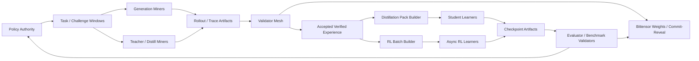

# Dual-Lane Subnet Decision Memo

## Purpose

This memo turns the current Reliquary research and PoC into a concrete product and engineering decision:

- Build a **dual-lane subnet**
- Ship **verified distillation** first
- Add **verified on-policy RL** second
- Treat frontier-scale learner training as a **separate trainer cluster problem**, not as something the average subnet miner performs directly

The core idea is simple: the subnet's durable commodity is not "backprop itself." The commodity is **verified experience**. That experience can be consumed in two ways:

1. as **distillation data**
2. as **on-policy RL training batches**

That lets us support "infinite training" and "data-as-commodity" at the same time.

## Executive Decision

### Decision

Reliquary should evolve into a **dual-lane verified experience subnet**:

- **Lane A: Verified Distillation**
  - miners generate teacher-backed or verifier-backed traces
  - validators check policy binding, formatting, task correctness, and novelty
  - packers aggregate accepted traces into reusable distillation packs
  - learners consume packs to produce student checkpoints

- **Lane B: Verified On-Policy RL**
  - miners generate policy-conditioned rollouts
  - validators replay and score them
  - learners consume accepted rollouts in async GRPO-style updates
  - new checkpoints become the next policy for future windows

### Why this is the right call

- The current Reliquary artifact model already fits this direction well.
- The current trainer is a genuine PoC for verified RL, but not a frontier-scale learner.
- Bittensor is a strong coordination and incentive plane for **commodity production and evaluation**, not a replacement for a dedicated multi-node frontier training stack.
- Distillation is cheaper, easier to validate, easier to scale across heterogeneous hardware, and easier to monetize early.
- RL remains strategically important, but it should start at `7B-32B` scale with async actor/learner separation.

### Hard truth on 600B

Reliquary is **not** currently ready to RL-train a `600B`-class model end to end. A frontier learner of that size needs dedicated distributed training backends, large memory budgets, multi-node orchestration, and specialized checkpointing/serving. The subnet should coordinate and feed that learner, not pretend every miner is one.

## Current-State Assessment

Reliquary already proves three important things:

- it can create **policy artifacts**
- it can collect **proof-carrying rollouts**
- it can turn accepted verdicts into a **training batch** and publish an updated checkpoint/policy

That is the right conceptual spine.

But the current implementation is still local-first and single-node in the parts that matter for scale:

- model loading is plain `AutoModelForCausalLM.from_pretrained(...)` into one device
- the trainer keeps both a trainable model and a reference model in memory
- GRPO updates run sample-by-sample with local AdamW
- the chain adapter is still mostly a publication scaffold around `set_weights`

So the PoC is valid, but the scale architecture is not there yet.

## Product Thesis

Reliquary should be the subnet for **verifiable post-training artifacts**.

Its job is to continuously produce and validate:

- rollouts
- traces
- judged outputs
- preference pairs
- reward annotations
- training batches
- learner checkpoints

These are the reusable building blocks for two live markets:

1. **A verified distillation market**
2. **A verified RL experience market**

The subnet never needs to force a false choice between them. The same accepted artifact can be:

- directly useful as distillation data
- useful as a reward-bearing RL sample
- useful as evaluation/audit evidence for learner checkpoints

## End-State Architecture



## The Two Lanes

## Lane A: Verified Distillation

### Goal

Turn high-value teacher outputs into a reusable commodity:

- reasoning traces
- solution traces
- tool-use traces
- synthetic instructions
- preference/judgment pairs

### How it works

1. A policy authority publishes a teacher or generation policy.
2. Miners generate traces against a task batch.
3. Validators check:
   - task formatting
   - policy or teacher provenance
   - answer correctness or judge agreement
   - novelty / non-duplication
   - contamination and benchmark overlap rules
4. Accepted traces become `DistillTraceArtifact`s.
5. Packers aggregate traces into `DistillPackArtifact`s with schemas and quality metadata.
6. Learners train students from accepted packs and publish checkpoints.

### Why this lane ships first

- lower hardware floor
- easier to verify than raw gradient contributions
- easier to sell as a reusable output
- compatible with centralized frontier teachers and decentralized student consumers

## Lane B: Verified On-Policy RL

### Goal

Continuously improve a subnet policy using accepted, proof-bound experience.

### How it works

1. Policy authority publishes a trainable policy for window `N`.
2. Miners generate rollouts under that policy.
3. Validators replay and score rollouts.
4. Accepted rollouts become `TrainingBatchArtifact`s.
5. Async learners consume batches and train an updated checkpoint.
6. The best validated checkpoint becomes policy `N+1`.

### Where RL starts

RL should begin with:

- `7B-32B` dense models
- async generation/training separation
- vLLM-backed rollout serving
- FSDP2-backed training

Not with:

- dense `600B` models
- raw decentralized gradient aggregation across arbitrary miners

## Recommended Stack

| Layer | Reliquary Today | Recommended Distillation Lane | Recommended RL Lane | Decision |
|---|---|---|---|---|
| Runtime | Python 3.12, local CLI | Python 3.12 | Python 3.12 | Keep |
| Model API | Hugging Face `transformers` | Hugging Face `transformers` | Hugging Face `transformers` for `<=32B`, Megatron-backed models for larger learners | Keep and extend |
| Fast inference | local HF generation | **vLLM** first, SGLang optional later | **vLLM** first for actor serving | Adopt |
| Synthetic data pipeline | hand-rolled artifacts | **Distilabel** for trace generation, judging, and pack assembly | reuse accepted artifacts, not Distilabel as primary trainer | Add |
| Small/medium learner backend | local torch loop | SFT / KD via HF or TRL stack | **TRL AsyncGRPO** for `7B-32B` | Replace current local trainer path |
| Large learner backend | none | optional SFT only | **NeMo RL** for multi-node GRPO / on-policy distillation / MoE paths | Add |
| Frontier parallelism | none | not required initially | **FSDP2 + tensor/pipeline parallelism**, with Megatron Core path where needed | Add later |
| Chain plane | local adapter + Bittensor `set_weights` scaffold | Bittensor subnet with commit-reveal enabled | same | Keep and harden |
| Artifact storage | local filesystem registry | local + object storage backend | local + object storage backend | Replace local-only assumption |
| Metadata/query layer | filesystem scan | lightweight DB index over immutable artifacts | same | Add |
| Checkpoint format | HF save_pretrained | HF checkpoints and LoRA deltas | HF for small/medium, Megatron/native for larger | Extend |
| Validation plane | single validator path | replay validators + task validators + judge validators | replay validators + reward validators + evaluator validators | Split into mesh |
| Observability | static dashboard | static dashboard + run index + metrics | same plus learner metrics | Extend |

## Why these stack choices

### vLLM first

vLLM is the right first rollout server because it is already the dominant open serving path for multi-GPU generation, it supports distributed inference, and it is already integrated in both TRL and Open-R1 style pipelines.

### Distilabel for distillation commodity production

Distilabel is a good fit for Reliquary's distillation lane because it already focuses on scalable synthetic data and AI-feedback pipelines. We should use it where it helps with generation, judging, and packaging, while keeping Reliquary's artifact contract as the source of truth.

### TRL AsyncGRPO for the first real RL lane

TRL's async GRPO model is the cleanest next step for Reliquary because it explicitly separates generation from training through a vLLM server. That is exactly the first architectural jump Reliquary needs beyond the local PoC.

### NeMo RL for the large-model lane

NeMo RL is the right scale-up target once we go beyond medium models because it supports:

- Ray-based resource management
- GRPO and on-policy distillation
- FSDP2 and larger-model backends
- MoE-oriented paths

This makes it a better long-term learner backend than trying to stretch the current Reliquary loop far past its intended size.

## Artifact Model

The subnet should move from a narrow "rollout only" artifact vocabulary to a dual-lane vocabulary with one shared envelope.

## Base Envelope

All artifacts should share this base shape:

```json
{
  "artifact_id": "sha256(...)",
  "artifact_type": "rollout",
  "lane": "rl",
  "producer_id": "miner-17",
  "producer_role": "generator",
  "policy_id": "policy-abc",
  "window_id": 12,
  "created_at": "2026-04-15T00:00:00Z",
  "parent_ids": ["challenge-1", "policy-abc"],
  "payload_hash": "sha256(...)",
  "signature_bundle": {"scheme": "ed25519"},
  "storage_refs": [{"kind": "r2", "uri": "r2://bucket/key"}],
  "verification_state": {
    "status": "pending",
    "validator_ids": [],
    "accepted": null
  },
  "payload": {}
}
```

## Required Artifact Types

### `PolicyArtifact`

Defines the active generation or learner policy.

Must include:

- model reference
- tokenizer reference
- generation config
- trainer config
- lane permissions
- evaluation contract

### `TaskBatchArtifact`

Generalizes today's challenge artifact.

Can represent:

- SAT challenges
- reasoning prompts
- code tasks
- judge tasks
- distillation prompts

Must include:

- task type
- prompt or structured input
- difficulty bucket
- contamination policy
- evaluation policy

### `RolloutArtifact`

Used in the RL lane.

Must include:

- prompt / input
- completion
- token IDs
- logprobs
- proof material
- tool traces if any
- generation metadata

### `DistillTraceArtifact`

Used in the distillation lane.

Must include:

- prompt
- teacher output
- optional reasoning trace
- answer / final response
- provenance of teacher or generating policy
- verification outcomes

### `VerdictArtifact`

Produced by validator mesh.

Must include:

- proof validity
- format validity
- task score
- dense reward if applicable
- uniqueness key
- novelty score
- contamination flags
- final acceptance decision
- explanation bundle

### `DistillPackArtifact`

Commodity pack for downstream learners.

Must include:

- source artifact IDs
- pack schema version
- task mixture
- quality summary
- dedup summary
- contamination summary
- export references (`jsonl`, `parquet`)

### `TrainingBatchArtifact`

Commodity pack for RL learners.

Must include:

- accepted source verdict IDs
- grouping structure
- reward summary
- policy binding reference
- learner compatibility metadata

### `CheckpointArtifact`

Represents a learner output.

Must include:

- parent policy
- training input refs
- training backend
- checkpoint format
- eval before / after
- benchmark results
- reproducibility metadata

### `ScorecardArtifact`

Represents validator scoring for a window.

Must include:

- miner totals
- learner totals where relevant
- validator metrics
- weight vector
- confidence / disagreement signals

### `WindowManifest` and `RunManifest`

Remain essential and should become lane-aware.

## Dual-Use Artifact Rule

Every accepted artifact should declare one of:

- `distill_only`
- `rl_only`
- `dual_use`

That gives us a clean contract for how accepted experience is consumed downstream.

## Economics

## Core economic principle

The subnet should reward **useful verified experience**, not raw token count.

### Primary miner commodities

- valid rollout artifacts
- valid distillation traces
- valid packed datasets
- validated learner checkpoints

### Primary validator job

Validators should not just check syntax. They should estimate whether an artifact is:

- valid
- unique
- difficult
- useful
- fresh
- actually improving the network's commodity quality

## Recommended scoring factors

### Generation miners

Score generation miners on:

- **validity gate**: proof, format, task correctness
- **uniqueness**: non-duplicate completions and traces
- **difficulty**: harder accepted tasks get more credit
- **utility**: downstream learner use and benchmark lift attribution
- **freshness**: newer useful artifacts score higher than stale repeated ones

### Packer / learner miners

If learners are represented as specialized miners, score them on:

- checkpoint provenance correctness
- holdout benchmark delta
- stability across windows
- ability to improve the active policy without regressions

### Validators

Bittensor already rewards validators through its own mechanism, so the main design job is to make copying unprofitable:

- enable commit-reveal
- rotate task mixes
- prefer moving targets over static tasks
- compare validator agreement and delayed benchmark outcomes
- slash confidence in validators who consistently over-score low-utility artifacts

## Recommended economic shape

### Stage 1

Focus all miner scoring on **artifact quality**:

- accepted verified traces
- accepted verified rollouts
- accepted verified packs

Do not pay for raw volume.

### Stage 2

Add **downstream utility attribution**:

- a distill pack gets extra credit if it improves a reference student
- an RL batch gets extra credit if checkpoints trained from it improve holdout metrics

### Stage 3

Add **learner competition**:

- multiple learner miners can publish checkpoints
- validators benchmark them
- the best validated checkpoint becomes the next policy authority input

## Policy Authority

Reliquary should not hard-code one permanent trainer.

Instead, define a `Policy Authority` layer that:

- publishes the active policy for the next window
- publishes allowed task families
- publishes evaluation contracts
- chooses which learner output becomes the next canonical policy

### Short-term

Single trusted trainer quorum or maintainer-operated authority.

### Medium-term

Validator-approved authority with checkpoint challenges and delayed benchmark review.

## What changes in Reliquary first

These are the first concrete code changes that matter.

### 1. Generalize the artifact protocol

First file to change:

- `reliquary/protocol/artifacts.py`

Add:

- `lane`
- `producer_role`
- `parent_ids`
- `storage_refs`
- `verification_state`
- new artifact types for `task_batch`, `distill_trace`, `distill_pack`

### 2. Split the registry into interface + backends

First file to change:

- `reliquary/storage/local_registry.py`

Add:

- `ArtifactRegistry` interface
- `LocalArtifactRegistry`
- `ObjectStoreArtifactRegistry`
- optional metadata index layer

The local registry remains useful for demo and testing, but object storage must become the production truth source.

### 3. Split miner into generator modes

First file to change:

- `reliquary/roles/miner.py`

Refactor into:

- rollout generator mode
- distillation trace generator mode
- teacher-backed trace mode
- optional judge mode later

### 4. Split validator into a mesh

First file to change:

- `reliquary/roles/validator.py`

Break current logic into pluggable validators:

- proof validator
- task validator
- uniqueness / dedup validator
- contamination validator
- pack validator
- benchmark / learner validator

### 5. Replace the trainer with backend adapters

First files to change:

- `reliquary/roles/trainer.py`
- `reliquary/training/grpo.py`

Create learner backends:

- `LocalLearnerBackend`
- `TRLAsyncGRPOBackend`
- `DistillationBackend`
- `NeMoLearnerBackend`

The current local GRPO path should stay for tests and showcase, but become just one backend.

### 6. Expand the chain adapter contract

First file to change:

- `reliquary/chain/adapters.py`

Add reference publishing for:

- task batches
- distill packs
- accepted training batches
- learner checkpoints
- policy authority decisions

The chain should publish references and scores, not large payloads.

### 7. Upgrade the showcase

Add a second showcase:

- `reliquary demo distill`

It should show:

- teacher trace creation
- validator acceptance
- pack export
- student fine-tune
- before / after eval

That will make the commercial story much clearer than SAT-only RL alone.

## Implementation Roadmap

## Phase 0: Protocol Refactor

### Goal

Make Reliquary's protocol dual-lane without losing the current demo.

### Deliverables

- generalized artifact envelope
- lane-aware manifests
- registry interface
- object storage backend scaffold
- updated docs and tests

### Exit criteria

- current showcase still works
- new artifact types can be stored and indexed

## Phase 1: Verified Distillation MVP

### Goal

Ship the first monetizable subnet commodity.

### Deliverables

- `distill_trace` generation path
- validator acceptance logic for traces
- pack builder exporting `jsonl` and `parquet`
- student learner path producing a checkpoint artifact
- `demo distill` operator flow

### Recommended stack

- vLLM for teacher generation
- Distilabel for packaging pipeline helpers
- HF/TRL or plain SFT backend for student fine-tuning

### Exit criteria

- accepted traces can be packed deterministically
- a student checkpoint trained from packs shows measurable lift on holdout tasks

## Phase 2: Async RL MVP

### Goal

Move from local synchronous RL to a real actor/learner architecture.

### Deliverables

- external vLLM rollout server
- async batch queue
- TRL AsyncGRPO backend
- stale-sample controls
- RL learner checkpoint publication

### Exit criteria

- `7B-32B` models can run with separate rollout and learner processes
- accepted rollouts are the only training source
- policy succession across windows is stable

## Phase 3: Testnet Subnet

### Goal

Turn the local product into an actual Bittensor subnet workflow.

### Deliverables

- testnet subnet creation
- validator commit-reveal configuration
- real weight publication
- object-store-backed artifact references
- validator disagreement and audit dashboards

### Exit criteria

- miners and validators can participate on testnet
- artifact references and weights are live
- copying pressure is visibly reduced by moving tasks and commit-reveal

## Phase 4: Learner Competition

### Goal

Decentralize the learner path without sacrificing checkpoint quality.

### Deliverables

- learner miner role
- benchmark validator role
- checkpoint challenge set
- policy authority election / selection process

### Exit criteria

- multiple learner outputs can be compared
- validators can reliably select the next policy

## Phase 5: Frontier Trainer Integration

### Goal

Let the subnet feed a true large-model trainer without pretending the whole subnet is that trainer.

### Deliverables

- NeMo RL learner backend
- larger-model checkpoint ingestion
- MoE-aware metadata
- optional dedicated trainer quorum

### Exit criteria

- a multi-node learner can ingest accepted subnet artifacts and publish validated checkpoints back into the network

## Scope boundaries

## In scope now

- verified distillation
- async RL for medium models
- object-store-backed artifact economy
- Bittensor coordination and weighting

## Explicitly not in scope now

- decentralized raw gradient averaging from arbitrary miners
- dense `600B` end-to-end RL on commodity miner hardware
- pretending chain consensus replaces dedicated learner infrastructure

## Success Metrics

The first version of the dual-lane subnet is working when all of these are true:

- distillation packs are exported and consumed by at least one learner path
- accepted rollouts produce reproducible RL batches
- validator decisions are auditable and not trivially copyable
- the active policy can improve across windows on held-out tasks
- the network can keep producing new useful artifacts continuously

## Immediate Next Build Recommendation

The next build should be:

**Phase 0 + Phase 1 together**

Concretely:

1. generalize artifacts
2. add object-store-ready registry seams
3. implement `distill_trace` and `distill_pack`
4. add a student learner backend
5. ship `reliquary demo distill`

That gives us the first real commodity and keeps the RL lane alive as the second milestone.

## Decision Summary

Build Reliquary as a **dual-lane verified experience subnet**.

- **Ship first**: verified distillation commodity
- **Build second**: async verified RL for `7B-32B`
- **Scale later**: frontier learner integration with dedicated multi-node backends

That path is ambitious without being delusional, and it uses the best part of the current PoC rather than throwing it away.

## Sources

- [Bittensor documentation](https://docs.learnbittensor.org/)
- [Bittensor validators](https://docs.learnbittensor.org/validators)
- [Bittensor commit-reveal](https://docs.learnbittensor.org/concepts/commit-reveal)
- [Bittensor create a subnet](https://docs.learnbittensor.org/subnets/create-a-subnet)
- [TRL GRPO Trainer](https://huggingface.co/docs/trl/grpo_trainer)
- [TRL Async GRPO](https://huggingface.co/docs/trl/async_grpo_trainer)
- [NeMo RL overview](https://docs.nvidia.com/nemo/rl/0.3.0/index.html)
- [NeMo RL GRPO guide](https://docs.nvidia.com/nemo/rl/latest/guides/grpo.html)
- [NeMo RL on-policy distillation](https://docs.nvidia.com/nemo/rl/latest/about/algorithms/on-policy-distillation.html)
- [TorchTitan](https://github.com/pytorch/torchtitan)
- [PyTorch distributed pipeline parallelism](https://docs.pytorch.org/docs/stable/distributed.pipelining.html)
- [DeepSpeed ZeRO-3](https://deepspeed.readthedocs.io/en/stable/zero3.html)
- [Open-R1](https://github.com/huggingface/open-r1)
- [Distilabel quickstart](https://distilabel.argilla.io/dev/sections/getting_started/quickstart/)
- [DeepSeek-R1 paper](https://arxiv.org/abs/2501.12948)
- [DeepSeek-V3 paper](https://arxiv.org/abs/2412.19437)
