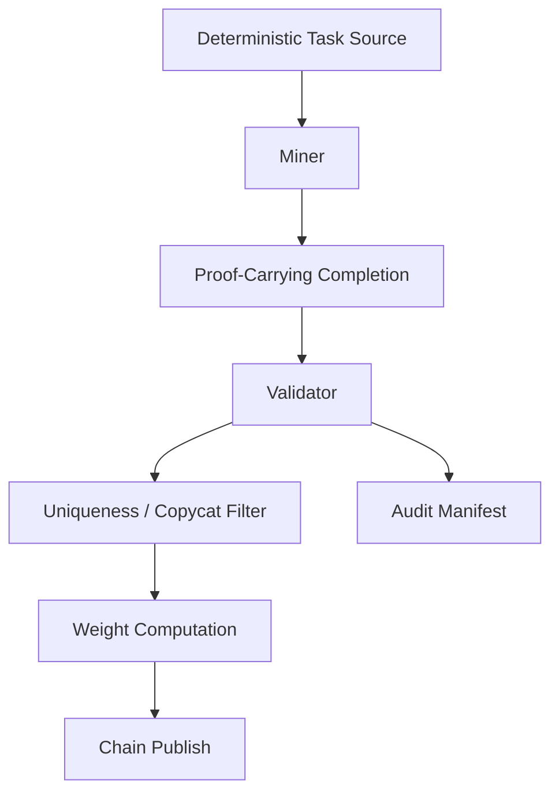

# Lightweight Inference Subnet Blueprint

This document defines a narrow inference-only subnet shape that fits inside the broader Reliquary platform.

The goal is to describe a smaller runtime with a much tighter surface area:

- inference-only
- proof-first
- faster to ship and operate
- easier for external operators to understand
- structurally compatible with the broader Reliquary platform

## Product Scope

Use this profile when the product is:

- a verifiable inference subnet
- a uniqueness market for proof-carrying completions
- a small-footprint runtime where miners and validators can be reasoned about end to end

Do not use it as the long-term home for:

- distillation packs
- learner checkpoints
- policy promotion
- RL rollouts
- async GRPO
- frontier trainer integration

## Core Thesis

The lightweight profile should be:

- proof-centric
- operationally clean
- explicit about artifacts and manifests
- small enough to stage on one GPU node
- compatible with later reintegration into the broader platform

## Recommended Structure

```text
lightweight-inference/
├── README.md
├── pyproject.toml
├── env.example
├── docs/
│   ├── architecture.md
│   ├── protocol.md
│   ├── deployment.md
│   └── scoring.md
├── deploy/
│   ├── bootstrap-node.sh
│   ├── install-environment.sh
│   ├── smoke-inference.sh
│   └── systemd/
│       ├── inference-miner.service
│       └── inference-validator.service
├── inference/
│   ├── cli.py
│   ├── config.py
│   ├── constants.py
│   ├── protocol/
│   ├── shared/
│   ├── dataset/
│   ├── miner/
│   ├── validator/
│   ├── chain/
│   └── storage/
└── tests/
```

## Included

- deterministic prompt/task selection
- miner generation
- proof construction
- validator-side proof replay
- uniqueness and copycat filtering
- score aggregation
- on-chain weight publication
- operator CLI
- minimal manifests and audit outputs
- lightweight deployment docs

## Excluded

- student training
- distillation pack export
- checkpoint benchmarking
- policy authority decisions
- RL lane
- FastAPI-heavy control-plane workflows
- multi-service learner orchestration

## Architecture



## Design Rules

1. Keep the runtime narrow enough that one engineer can reason about it end to end.
2. Keep proof and verification logic bit-stable across miner and validator paths.
3. Use a minimal artifact vocabulary, but make manifests explicit enough to migrate into the broader platform.
4. Prefer clean modular reuse over copying entire runtime stacks.
5. Keep the repo inference-first, not a partial training stack.

## Reusable Technical Surface

The lightweight profile should reuse these categories of components:

- proof primitives
- signature binding
- shared forward-path replay
- copycat and uniqueness filters
- deterministic task-source loaders
- explicit env/config handling
- manifest generation
- bootstrap, smoke, and systemd deployment patterns

## What To Leave Out

The lightweight runtime should not expose:

- learner backends
- policy authority logic
- benchmark-driven checkpoint promotion
- control-plane-heavy orchestration
- RL-specific batch builders or trainers

Those belong in the broader Reliquary platform.

## Artifact Model

Use a small artifact envelope:

```json
{
  "artifact_id": "sha256...",
  "artifact_type": "task_batch | completion | verdict | scorecard | window_manifest | run_manifest",
  "producer_id": "miner-or-validator-id",
  "producer_role": "miner | validator",
  "window_id": 123,
  "created_at": "2026-04-15T00:00:00Z",
  "parent_ids": [],
  "payload": {}
}
```

Recommended families:

- `task_batch`
- `completion`
- `verdict`
- `scorecard`
- `window_manifest`
- `run_manifest`

## Why This Blueprint Exists

This profile gives Reliquary a compact inference runtime that can be launched, audited, and iterated independently, while still staying structurally aligned with the broader platform.
